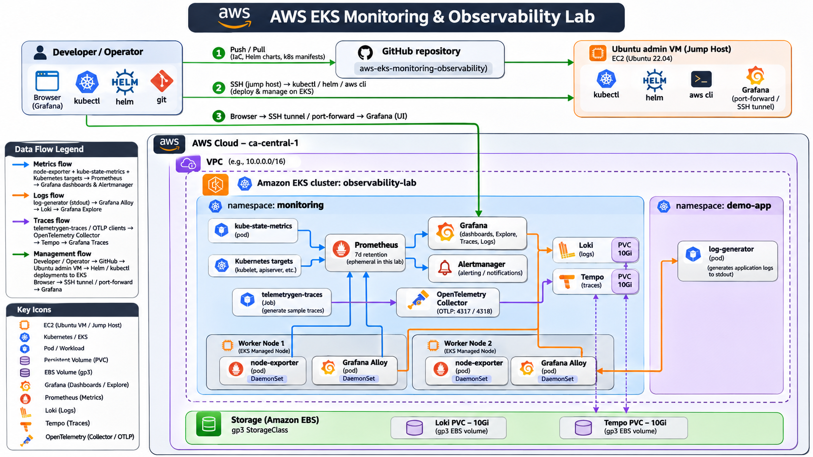

# AWS EKS Monitoring & Observability

A hands-on DevOps project implementing the three pillars of observability—metrics, logs, and distributed traces—on Amazon Elastic Kubernetes Service (EKS).

## Infrastructure Architecture



## Architecture

**Metrics**
Kubernetes Exporters → Prometheus → Grafana

**Logs**
Kubernetes Pods → Grafana Alloy → Loki → Grafana

**Distributed Traces**
Telemetrygen → OpenTelemetry Collector → Grafana Tempo → Grafana

## AWS Infrastructure

- Region: ca-central-1 (Canada Central)
- EKS Cluster: observability-lab
- Managed Node Group: monitoring-nodes
- Worker Nodes: 2 × t3.large
- Storage: AWS EBS CSI Driver and gp3 StorageClass
- Deployment: Helm and Kubernetes manifests

## Observability Components

| Component | Purpose |
|-----------|---------|
| Prometheus | Metrics collection and time-series storage |
| Grafana | Dashboards and telemetry visualization |
| Alertmanager | Alert processing and routing |
| kube-state-metrics | Kubernetes object-state metrics |
| Node Exporter | Worker node CPU, memory, disk, and network metrics |
| Grafana Alloy | Collects Kubernetes container logs |
| Grafana Loki | Stores and queries logs using LogQL |
| Grafana Tempo | Stores and queries distributed traces |
| OpenTelemetry Collector | Receives and exports OTLP traces |

## Persistent Storage

- Loki: 10Gi AWS EBS gp3
- Tempo: 10Gi AWS EBS gp3
- Prometheus: ephemeral emptyDir storage for this lab

## Hands-on Validation

### 1. Metrics

Used Prometheus and PromQL to inspect scrape health, CPU utilization, and memory availability.

Example:

```promql
up
```

### 2. Centralized Logging

Deployed a BusyBox log-generator application producing simulated INFO, WARN, and ERROR events.

Grafana Alloy collects application logs and sends them to Loki.

Example LogQL query:

```logql
{cluster="observability-lab", namespace="demo-app"} |= "ERROR"
```

Created a Grafana dashboard visualizing application error frequency.

### 3. Distributed Tracing

Deployed an OpenTelemetry Collector to receive traces over OTLP gRPC and forward them to Tempo.

Generated synthetic spans with a Kubernetes telemetrygen Job and successfully queried them in Grafana.

Example TraceQL query:

```traceql
{ resource.service.name = "eks-observability-demo" }
```

Verified a test trace containing two spans in Grafana Tempo.

## Troubleshooting Experience

- Resolved AWS IAM permission and credential issues during EKS provisioning.
- Configured EBS CSI Pod Identity permissions and gp3 persistent volumes.
- Validated Helm charts before deployment.
- Resolved Tempo connectivity by correcting the Grafana data source port from 3100 to 3200.
- Investigated Loki startup errors and verified service readiness.
- Investigated OpenTelemetry exporter naming compatibility and Helm deprecation warnings.
- Troubleshot Kubernetes Job completion timeouts and verified successful execution.
- Validated Kubernetes Services and EndpointSlices.

## Project Structure

- `eks/` — EKS cluster configuration
- `helm/` — Helm values for observability components
- `k8s/` — Kubernetes manifests and test workloads
- `iam/` — IAM trust policy configuration
- `grafana/dashboards/` — Exported Grafana dashboard

## Key Learning Outcomes

- Amazon EKS cluster deployment and operations
- Kubernetes Deployments, StatefulSets, DaemonSets, Services, and Jobs
- Helm chart configuration and validation
- Kubernetes persistent storage with AWS EBS
- PromQL, LogQL, and TraceQL
- OpenTelemetry distributed tracing
- Monitoring pipeline validation and troubleshooting

## Notes

This is a learning environment, not a production-ready platform.

The EKS infrastructure incurs AWS charges while running.
